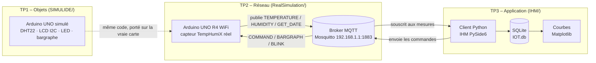

# Projet IoT – Capteur TempHumiX

Projet IoT réalisé à l'IMT Nord Europe (CERI Systèmes Numériques) : une chaîne complète de
relevé de **température et d'humidité**, du capteur jusqu'à l'interface utilisateur et la base
de données. Le capteur est identifié par le numéro de poste **42920**.

Le projet est découpé en **3 TP**, un par couche de l'architecture IoT.

## Architecture



| TP | Couche | Ce qu'on y fait |
|----|--------|-----------------|
| **TP1** | Objets (capteurs / actionneurs) | Montages simulés sous SimulIDE, ajoutés un composant à la fois |
| **TP2** | Réseau | Wi-Fi, NTP et MQTT sur l'Arduino UNO R4, puis analyse des trames avec Wireshark |
| **TP3** | Application | Client MQTT Python, IHM PySide6, archivage SQLite et courbes |

## Organisation du dépôt

```
IOT_elfergouch/
├── SIMULIDE/              TP1 – un dossier par montage (.ino + .sim1)
│   ├── clignotement_led/    LED sur la broche 2
│   ├── bargraphe/           chenillard sur 10 LED
│   ├── capteur_dht22/       LED verte/rouge selon un seuil de température
│   ├── lcd_i2c/             « HELLO WORLD » sur LCD I2C
│   ├── lcd_i2c_dht22/       mesure affichée sur le LCD
│   └── TempHumiX/           capteur complet (dateur, LED de vie, port série)
│
├── RealSimulation/        TP2 – croquis Arduino UNO R4, dans l'ordre du TP
│   ├── TempAquisition/      passage de R3 à R4 (LCD Grove)
│   ├── Temp_RTC/            horloge RTC interne
│   ├── date_WIFI/           connexion Wi-Fi et synchro NTP
│   ├── ArduinoMQTTClient/   publication des mesures
│   ├── SouscriptionParams/  réception des commandes
│   └── OptimisationMQTT/    version finale : publie seulement si la valeur change
│
├── IHM/                   TP3 – programmes Python (PyCharm)
│   ├── console_mqtt_lecture/    client console qui lit les mesures
│   ├── console_mqtt_ecriture/   client console qui envoie les commandes
│   ├── console_mqtt_thread/     lecture et écriture réunies grâce à un thread
│   └── ihm_mqtt_simple/         IHM PySide6 + base SQLite + courbes (version finale)
│
└── Compte Rendu_VF.pdf    compte rendu final des 3 TP
```

> Pour lancer l'IHM finale : `pip install paho-mqtt PySide6 matplotlib`, puis
> `python IHM/ihm_mqtt_simple/main.py`.

## Le rapport

Le compte rendu final est **`Compte Rendu_VF.pdf`**, à la racine du dépôt. Il suit les 3 TP.
Chaque partie commence par le lien avec le cours, puis montre les résultats (captures
SimulIDE, MQTTX, Wireshark, IHM) et répond aux questions de l'énoncé.

